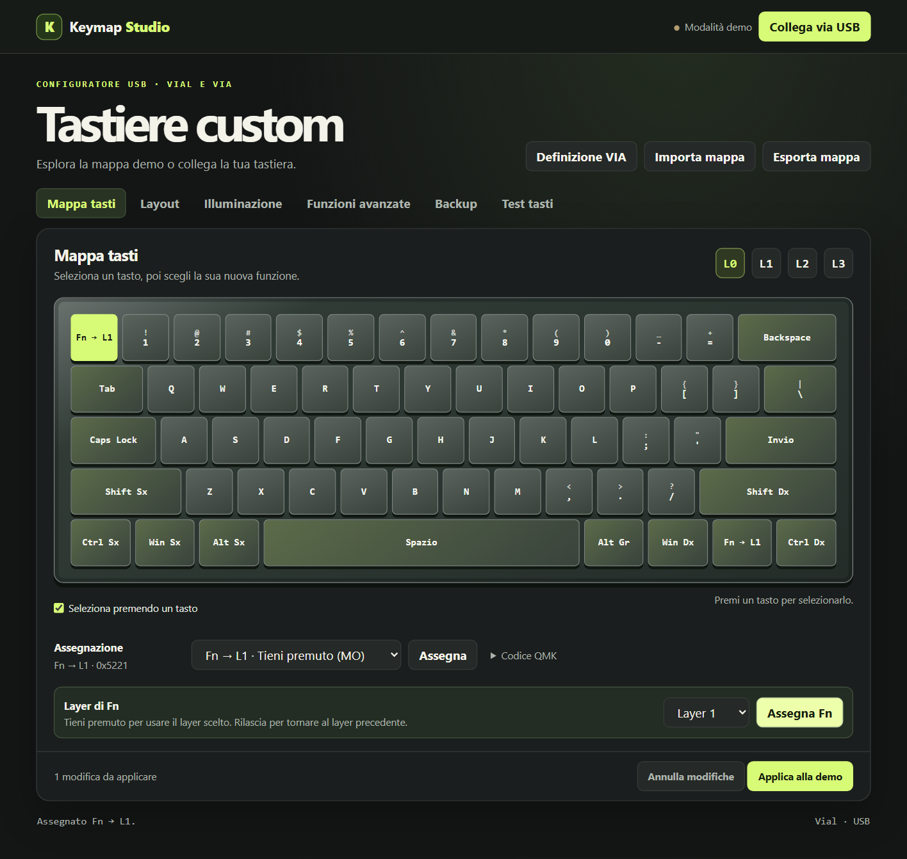

# Keymap Studio

**Configuratore open source per tastiere custom Vial e VIA.** Rimappa i tasti, crea layer Fn e personalizza RGB, macro e layout da un’app portatile per Windows.

[**Scarica per Windows**](https://github.com/Leonixttv/keymap-studio/releases/latest) · [Sito del progetto](https://leonixttv.github.io/keymap-studio/) · [Segnala un problema](https://github.com/Leonixttv/keymap-studio/issues)

## Per iniziare

1. Scarica e avvia il file EXE portatile per Windows x64.
2. Con **Vial 5 o 6**, premi **Collega via USB**. Con **VIA 12 o 13**, carica prima il JSON del produttore da **Definizione VIA**.
3. Seleziona un tasto sulla mappa o premilo fisicamente. Assegna una funzione o premi **Assegna Fn** per collegarlo a un layer.
4. Premi **Scrivi sulla tastiera** per rendere persistenti le modifiche. Usa **Backup** prima di modificare una configurazione importante.

Funziona offline. Le funzioni disponibili dipendono dal firmware. Il flusso USB è stato verificato con dispositivi simulati. L’EXE di questa release è senza firma digitale.

## Codice e contributi

Leggi la [guida all’uso e alla compilazione](LEGGIMI.md). Per segnalare un problema, indica il modello, il firmware, la versione di Keymap Studio e i passaggi per riprodurlo.

Il progetto è distribuito con licenza [GPL-2.0-or-later](COPYING). I componenti di terze parti mantengono le rispettive licenze.
